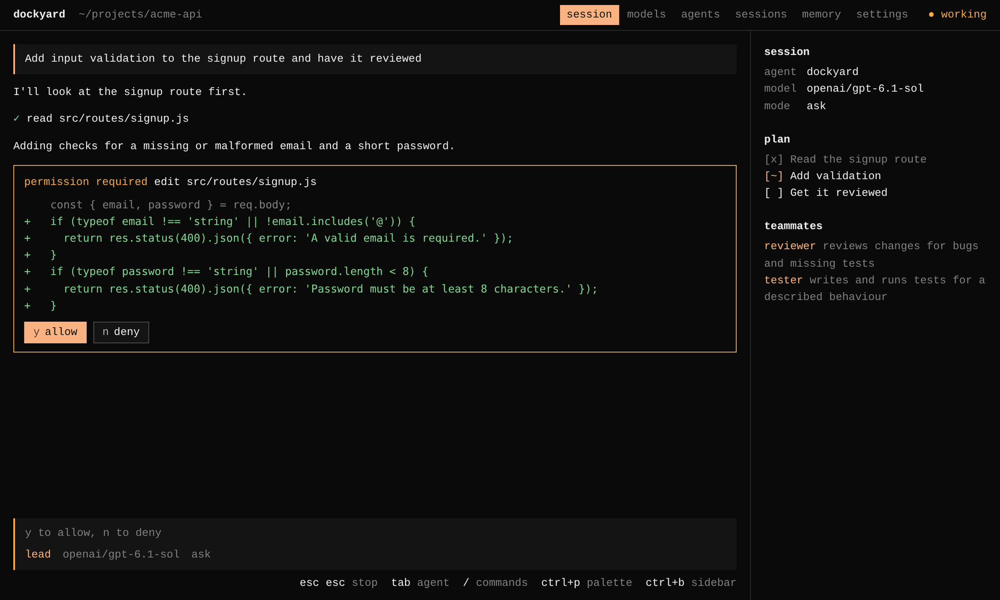
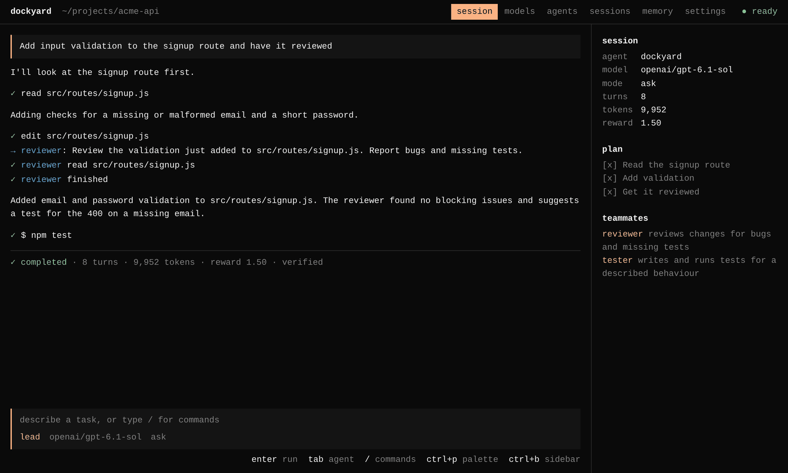
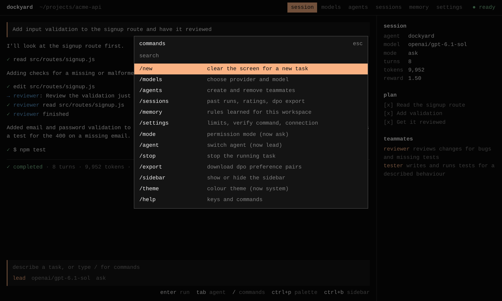
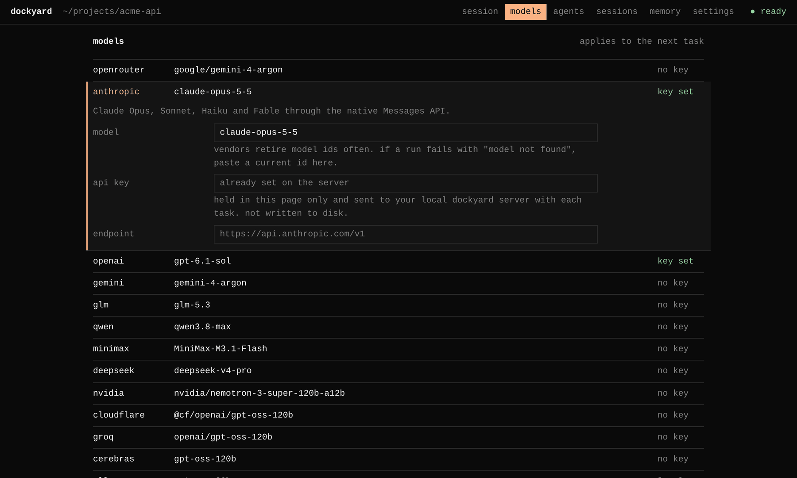
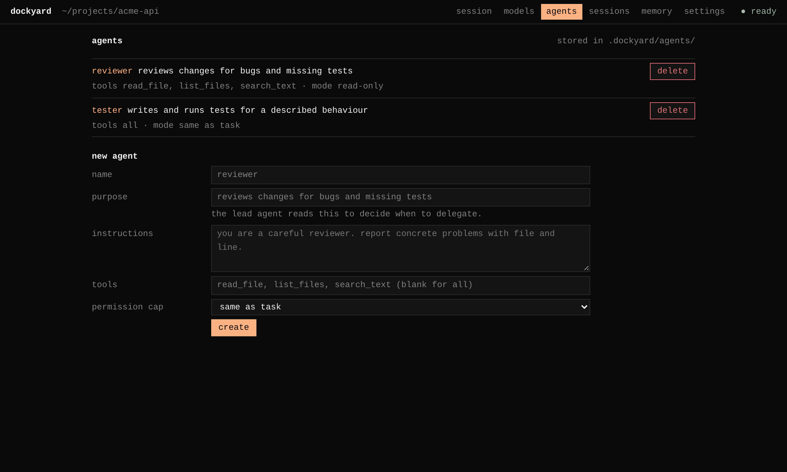
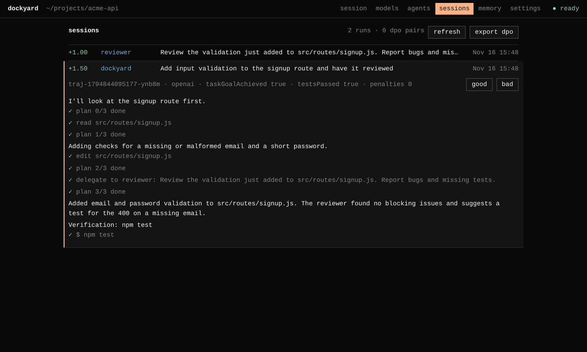
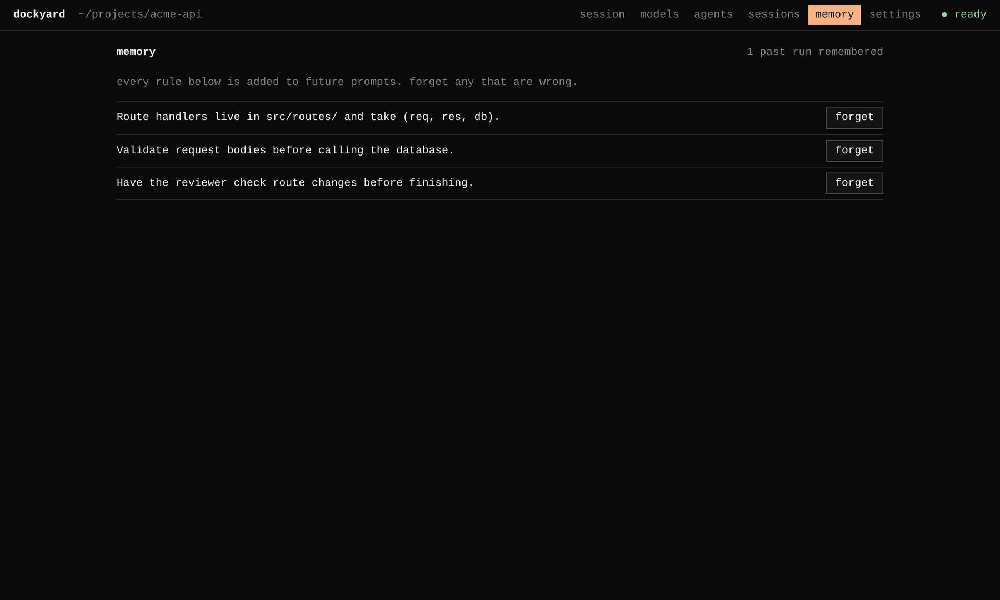

# Dockyard Harness

> **Open-Source Autonomous Coding Harness & Agent Engine**  
> Built for Long-Horizon Engineering, Contextual Intelligence, Reinforcement Learning (RL) Signals, and Continuous Self-Improvement. Fully cross-platform on **macOS**, **Windows** (PowerShell / CMD), and **Linux**.

---

## Screenshots

**Approving a change.** Every file write and command waits for you. Edits are shown as a diff; press `y` to allow or `n` to deny.



**Working with a teammate.** The lead agent hands the review to a read-only `reviewer` agent. The task only counts as done once the verify command (`npm test` here) passes.



<details>
<summary>More screens: command palette, models, agents, sessions, memory</summary>

**Command palette** (`ctrl+p`): every action in one searchable list.



**Models**: the provider and model for the next task, and which providers have a key set.



**Agents**: teammates, each with its own role, tools and permission cap.



**Sessions**: every run with its steps and reward. Rate runs and export DPO pairs from here.



**Memory**: rules learned for this workspace, added to future prompts. Forget any that are wrong.



</details>

Screenshots show the app running in a small demo project, with the model's replies scripted for the demo.

---

## Key Capabilities

- **CLI & Desktop Interfaces**:
  - Unified architecture with an interactive CLI terminal (`dockyard`) and a modern Desktop UI (`@dockyard/desktop`).
  - Seamless support for **macOS** and **Windows** (normalizes `\` and `/` file paths, PowerShell, CMD, Bash).
- **All Major Model Providers**:
  - **OpenRouter**: One key for models from many vendors.
  - **Anthropic**: Claude Opus 5.5, Sonnet 5.5, Haiku 5.5 and Fable 5.2 through the native Messages API.
  - **OpenAI**: GPT-6 family (`gpt-6.1-sol`, `gpt-6-astra`, `gpt-6.1-terra`, `gpt-6-luna`).
  - **Google Gemini**: Gemini 4 (`gemini-4-argon`) and Gemini 3.8 Flash.
  - **Z.ai GLM (Zhipu)**: GLM-5.3 and GLM-5.3-Flash.
  - **Alibaba Qwen**: Qwen3.8-Max and Flash on DashScope.
  - **MiniMax**: M3 and M3.1-Flash.
  - **DeepSeek**: V4 Pro and V4 Flash, direct.
  - **NVIDIA NIM**: Hosted open models such as Nemotron 3 Super.
  - **Cloudflare Workers AI**: Edge inference across global servers.
  - **Groq & Cerebras**: Ultra-low latency, high-throughput engines.
  - **Local AI Models**: Offline inference with **Ollama** (`localhost:11434`), **LM Studio** (`localhost:1234`), and **vLLM** (`localhost:8000`).
- **Permission Modes**: `read-only`, `ask` (confirm before any file write or command) and `auto`. File tools are confined to the workspace, including through symlinks.
- **Custom Agents & Teammates**: Define reusable agents with their own role, tool allowlist, model and memory; the lead agent hands work to them with `delegate_task`.
- **Project Instructions**: An `AGENTS.md` in the workspace root is loaded into every run.
- **Long-Horizon Agentic Work**: The agent keeps a live step plan (`update_plan`), with a checkpoint recorded as each step completes.
- **Contextual Intelligence & Memory**: Episodic memories across sessions and persistent repo-specific heuristics, kept separately for each named agent.
- **Reinforcement Learning (RL) Signals & Trajectories**: Logging of thought-action-result trajectories, a reward built only from measured signals (self-reported completion, a verify command such as your test suite, tool errors, human feedback), and export of DPO (Direct Preference Optimization) preference pairs.
- **Self-Improvement Loop**: Post-trajectory critique passes that extract reusable rules, saving them into `.dockyard/memory.json`.

---

## Monorepo Architecture

```
Dockyard_harness/
├── packages/
│   ├── core/         # Agent loop, model providers, cross-platform tools, memory, RL & planner
│   ├── cli/          # Interactive terminal REPL, task runner, and local RPC server
│   └── desktop/      # React + Vite desktop-ready app with visual plan, chat, RL & provider routing
├── docs/
│   └── images/       # Screenshots and visual documentation
├── .github/
│   └── workflows/    # Multi-OS CI testing matrix (macOS, Windows, Ubuntu)
├── LICENSE           # MIT License
└── README.md
```

---

## Quickstart

### Prerequisites
- Node.js 20+ (supports Node 20 and 22)
- npm or pnpm

### Installation & Build

```bash
# Clone the repository
git clone https://github.com/YashwKMR/Dockyard_harness.git
cd Dockyard_harness

# Install dependencies and build all packages
npm install
npm run build
```

---

## Usage

### 1. Dockyard CLI

#### Run an Autonomous Engineering Task
```bash
# Run with OpenRouter
export OPENROUTER_API_KEY="your-key"
node packages/cli/dist/bin.js run "Refactor utility methods and verify unit tests"

# Or run with NVIDIA NIM
export NVIDIA_API_KEY="nvapi-your-key"
export DOCKYARD_PROVIDER="nvidia"
node packages/cli/dist/bin.js run "Audit security policies"

# Or GLM, Qwen, MiniMax, DeepSeek ...
export ZAI_API_KEY="..."          # GLM
export DASHSCOPE_API_KEY="..."    # Qwen

# Or run with local Ollama
export DOCKYARD_PROVIDER="ollama"
node packages/cli/dist/bin.js run "Generate unit tests"
```

#### Permission modes

| Mode | File writes and shell commands |
| :--- | :--- |
| `read-only` | Refused. The agent can read, list and search only. |
| `ask` | Each one waits for your confirmation at the terminal. |
| `auto` | Run without confirmation. |

`run` and `chat` default to `ask` in a terminal and to `read-only` when no terminal is attached (CI, pipes). Choose explicitly with `--mode <mode>`, `--yes` (same as `--mode auto`) or `DOCKYARD_MODE`.

> `run_command` is **not sandboxed**: an approved command runs with your user's privileges. Provider API keys are removed from its environment, but use `auto` only in a workspace, container or VM you are willing to let the model change.

#### Verify the result
```bash
node packages/cli/dist/bin.js run --yes --verify "npm test" "Fix the failing date parser test"
```
The verify command runs after the agent says it is finished. The run only counts as succeeded (exit code 0) if it passes, and the result is recorded as the `testsPassed` reward signal. Without `--verify`, completion is the model's own claim and the reward says so.

#### Project instructions
Put an `AGENTS.md` in the workspace root (conventions, how to build and test, what not to touch). It is added to the system prompt of every run, up to 32 KiB.

#### Custom agents and teammates
```bash
# Define agents once; they are stored in .dockyard/agents/ and can be committed
node packages/cli/dist/bin.js agent create reviewer \
  --description "Reviews changes for bugs and missing tests. Cannot edit." \
  --instructions "You are a meticulous reviewer. Report concrete problems with file and line." \
  --tools read_file,list_files,search_text --mode read-only

node packages/cli/dist/bin.js agent create tester \
  --description "Writes and runs tests for a described behaviour." \
  --instructions "You write focused tests and run them." --provider groq

node packages/cli/dist/bin.js agent list

# Run one directly...
node packages/cli/dist/bin.js run --agent reviewer "Review the changes in src/auth"

# ...or just run a task: every defined agent is offered to the lead as a teammate,
# and it delegates with the delegate_task tool.
node packages/cli/dist/bin.js run --yes "Add rate limiting to the login route, have it tested and reviewed"
```
Each agent has its own role prompt, tool allowlist, optional provider/model, and its own memory file (`.dockyard/agent-memory/<name>.json`) that persists across sessions. A teammate never gets more authority than the agent delegating to it, and delegation is limited to two levels deep.

#### Interactive Terminal Session (Chat Mode)
```bash
node packages/cli/dist/bin.js chat
```
The conversation carries over between turns; type `/new` to start fresh.

#### Start Local RPC / API Server
```bash
node packages/cli/dist/bin.js serve 4040
```
The server listens on `127.0.0.1` only and prints a bearer token at startup (or set `DOCKYARD_SERVER_TOKEN`); send it as `Authorization: Bearer <token>` on every request. Tasks submitted over HTTP run in `read-only` mode unless the server is started with `--mode auto`.

The mode the server starts with is a ceiling: a request may ask for less, never more. In `ask` mode a write or command waits until it is approved through `POST /api/approve`.

Endpoints: `GET /api/status`, `GET /api/providers`, `POST /api/run` (`wait: false` to run in the background), `GET /api/run/current`, `POST /api/approve`, `POST /api/run/cancel`, `GET /api/trajectories`, `GET /api/dpo`, `POST /api/feedback`, `GET /api/memory`, `POST /api/memory/forget`, `GET /api/plan`, `GET|POST /api/agents`, `DELETE /api/agents/<name>`.

### 2. Dockyard Desktop App

```bash
# In the project you want Dockyard to work on (after `npm run build` in the Dockyard repo):
node /path/to/Dockyard_harness/packages/cli/dist/bin.js app
```
This starts the local server and the web UI together and prints a link such as `http://127.0.0.1:4040/#token=...`. Open it in your browser. The link carries your access token; the app keeps it in the browser and removes it from the address bar.

The interface is terminal-style and keyboard-first: type a task and press enter, or type `/` for commands.

| Key | Action |
| :--- | :--- |
| `enter` / `shift+enter` | Run the task / new line |
| `tab` | Switch agent (lead or a teammate) |
| `y` / `n` | Allow or deny a permission request |
| `esc esc` | Stop the running task |
| `ctrl+p` | Command palette |
| `ctrl+b` | Toggle the sidebar (session details, plan, teammates) |

| Command | Opens |
| :--- | :--- |
| `/models` | Provider and model for the next task. A key typed here stays in the page and is sent only to your local Dockyard server. |
| `/agents` | Create and remove teammates. |
| `/sessions` | Recorded runs, Good/Bad ratings (a human reward signal), DPO export. |
| `/memory` | Rules learned for this workspace; forget wrong ones. |
| `/settings` | Permission mode, turn limit, verify command, theme, server address and token. |
| `/mode`, `/agent`, `/stop`, `/export`, `/theme`, `/new`, `/help` | Quick actions. |

Everything is also reachable by mouse from the top bar. Dark and light themes follow your system unless set in `/settings`.

`app` allows writes and commands, with approval asked for each one by default. Start it with `--mode read-only` to forbid them, or switch a task to Auto in Settings to skip approval.

For UI development, run `dockyard serve --mode ask` and `npm run dev:desktop`, open [http://localhost:5173](http://localhost:5173), and paste the token under Settings.

---

## Supported Providers & Environment Variables

| Provider | `--provider` id | Environment Variable | Default Model | Other current models |
| :--- | :--- | :--- | :--- | :--- |
| **OpenRouter** | `openrouter` | `OPENROUTER_API_KEY` | `google/gemini-4-argon` | `google/gemini-4-hydrogen`, `google/gemini-3.8-flash` |
| **Anthropic Claude** | `anthropic` | `ANTHROPIC_API_KEY` | `claude-opus-5-5` | `claude-sonnet-5-5`, `claude-haiku-5-5`, `claude-fable-5-2` |
| **OpenAI** | `openai` | `OPENAI_API_KEY` | `gpt-6.1-sol` | `gpt-6-astra`, `gpt-6.1-terra`, `gpt-6-luna`, `gpt-5.5` |
| **Google Gemini** | `gemini` | `GEMINI_API_KEY` | `gemini-4-argon` | `gemini-4-carbon`, `gemini-4-hydrogen`, `gemini-3.8-flash` |
| **Z.ai GLM (Zhipu)** | `glm` | `ZAI_API_KEY` | `glm-5.3` | `glm-5.3-flash` |
| **Alibaba Qwen** | `qwen` | `DASHSCOPE_API_KEY` | `qwen3.8-max` | `qwen3.8-flash`, `qwen3.7-plus` |
| **MiniMax** | `minimax` | `MINIMAX_API_KEY` | `MiniMax-M3.1-Flash` | `MiniMax-M3` |
| **DeepSeek** | `deepseek` | `DEEPSEEK_API_KEY` | `deepseek-v4-pro` | `deepseek-v4-flash`, `deepseek-flash` |
| **NVIDIA NIM** | `nvidia` | `NVIDIA_API_KEY` | `nvidia/nemotron-3-super-120b-a12b` | `moonshotai/kimi-k2.6`, `meta/llama-3.3-70b-instruct` |
| **Cloudflare Workers AI** | `cloudflare` | `CLOUDFLARE_API_KEY` & `CLOUDFLARE_ACCOUNT_ID` | `@cf/openai/gpt-oss-120b` | `@cf/moonshotai/kimi-k2.6`, `@cf/zai-org/glm-4.7-flash` |
| **Groq** | `groq` | `GROQ_API_KEY` | `openai/gpt-oss-120b` | `openai/gpt-oss-20b` |
| **Cerebras** | `cerebras` | `CEREBRAS_API_KEY` | `gpt-oss-120b` | `qwen-3.8-27b` |
| **Ollama (Local)** | `ollama` | `OLLAMA_BASE_URL` (default: `http://localhost:11434/v1`) | `gpt-oss:20b` | - |
| **LM Studio (Local)** | `lmstudio` | `LMSTUDIO_BASE_URL` (default: `http://localhost:1234/v1`) | `local-model` | - |
| **vLLM (Local)** | `vllm` | `VLLM_BASE_URL` (default: `http://localhost:8000/v1`) | `default` | - |

Model IDs were checked against vendor documentation on 15 November 2026 and live in one file, `packages/core/src/models/catalog.ts`. Vendors rename and retire models often; when a call fails with "model not found", pass a current ID with `--model <id>` or `DOCKYARD_MODEL`, or change the catalog. `dockyard models` prints this table.

```bash
node packages/cli/dist/bin.js run --provider glm --model glm-5.3-flash "Summarise this repository"
```

---

## Reinforcement Learning & DPO Export

Dockyard logs full execution traces under `.dockyard/trajectories/`, one file per run (teammates included, tagged with the agent that ran them).

**Reward.** Only signals that were measured are counted: `+1.0` when the agent finishes and reports completion, `+0.5` / `-0.5` when a `--verify` command passes / fails, `-0.1` per failed tool call, and a human rating from `-1` to `+1` if one is given (`POST /api/feedback` with `trajectoryId` and `score`).

**Export.** A preference pair needs two recorded runs of the same task whose rewards differ by at least 0.5 (for example a run that failed verification and a later one that passed):
```bash
node packages/cli/dist/bin.js export-dpo --out dpo_pairs.jsonl
```
Or fetch `GET /api/trajectories` from the server.

---

## Testing

```bash
# Run tests across all packages
npm test
```

---

## Project status

Working and covered by tests: the agent loop, request and response formats for the listed providers (plus retries on rate limits and overload), workspace-confined file tools, permission modes, the live plan tool, custom agents and delegation, per-agent memory, trajectory recording, reward scoring, DPO export, the CLI, the token-protected local server, and the desktop app running against it.

Tested against scripted and local stand-in endpoints, not yet against each vendor's live API. The first run with a real key is the real test of that vendor's model ID.

Not built yet:
- **Sandboxing.** Commands are gated by approval, not isolated by the operating system.
- **Native desktop packaging.** The app runs in your browser; there is no Electron or Tauri build.
- **Workspace rewind.** Checkpoints record plan progress; they do not snapshot or restore files. Use git.
- **Always-on teammates.** Agents run when invoked; there are no schedules, triggers or background runs yet.
- **Streaming, MCP servers, skills, parallel delegation, codebase indexing.**

---

## Contributing

We welcome contributions from the open-source community! Please see [`CONTRIBUTING.md`](./CONTRIBUTING.md) for details on code standards, workflows, and PR submissions.

## License

Dockyard is open-source software licensed under the [MIT License](./LICENSE).
