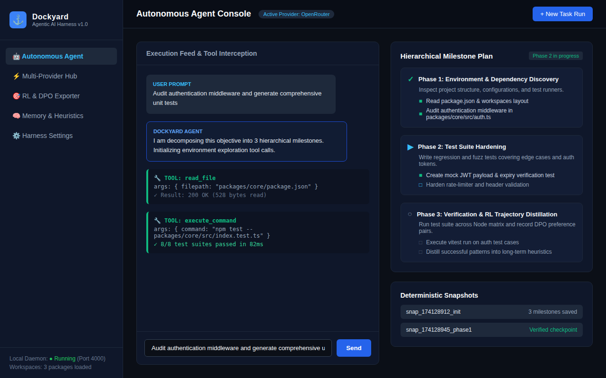
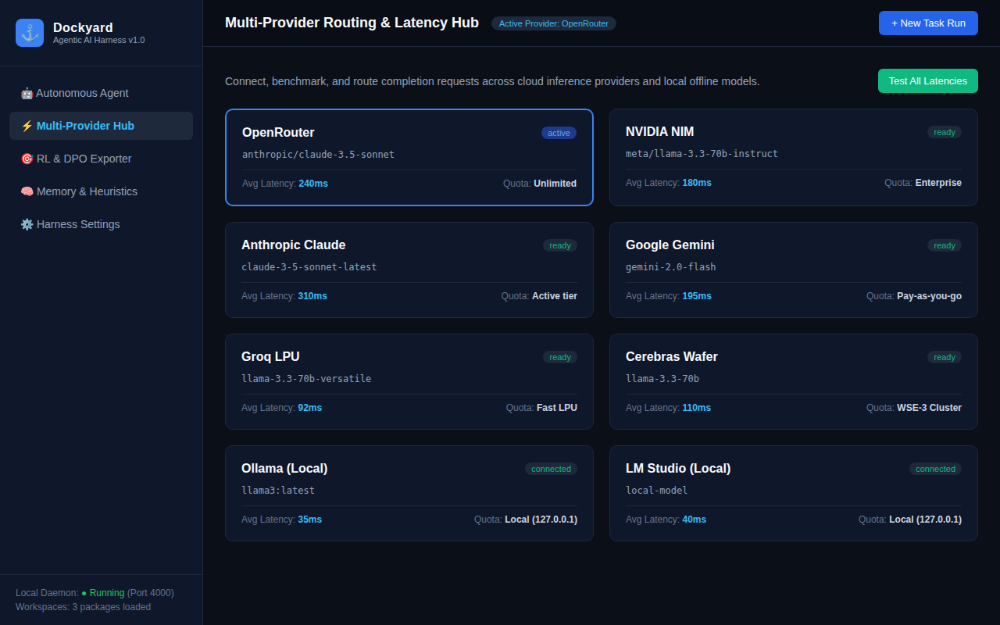
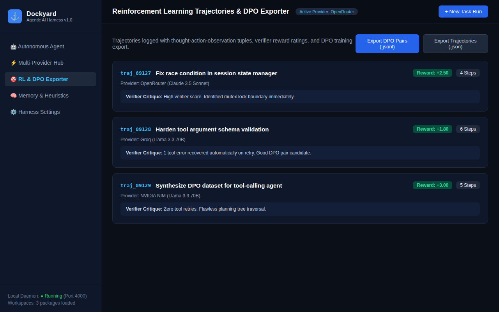

# ⚓ Dockyard Harness

> **Autonomous Multi-Provider Agentic AI Harness with Hierarchical Planning, Cross-Platform Sandbox, RL Trajectory Recorder, and DPO Dataset Exporter.**

[](https://github.com/yashwant0906/Dockyard_harness/actions/workflows/ci.yml)
[](https://opensource.org/licenses/MIT)
[](https://nodejs.org/)

---

## 🌟 Key Highlights

- 🤖 **Autonomous Multi-Turn Agent Loop**: Goal-directed reasoning tree traversing complex multi-step coding and verification workflows.
- ⚡ **Multi-Provider Model Routing**: Unified completion interface supporting **OpenRouter**, **NVIDIA NIM**, **Anthropic Claude**, **Google Gemini**, **Groq LPU**, **Cerebras**, and local offline inference via **Ollama** and **LM Studio**.
- 📋 **Hierarchical Milestone Planning**: Decomposes high-level requests into milestones and subtasks with automatic snapshot rollback and progress checkpointing.
- 🔧 **Cross-Platform Tool Sandbox**: Secure, timeout-guarded execution across POSIX shell, Windows Cmd, and PowerShell, combined with file reading, writing, and directory traversal.
- 🧠 **Multi-Tier Memory & Self-Improvement**: Working scratchpad, proven pattern heuristics, and automatic error-recovery rule distillation from failed tool invocations.
- 🎯 **RL Trajectory Recorder & DPO Exporter**: Captures thought-action-observation tuples, verifier reward scorings, and exports paired preference datasets directly into standard `.jsonl` for Direct Preference Optimization (DPO).
- 🖥️ **Desktop Dashboard & CLI**: Rich graphical interface (`@dockyard/desktop`) and terminal daemon (`@dockyard/cli`).

---

## 📸 Screenshots & Visual Tour

### 1. Autonomous Agent & Milestone Execution Console
Inspect real-time tool calls, thoughts, observations, and track hierarchical milestone progress.


---

### 2. Multi-Provider Routing Hub
Configure API endpoints, compare latency metrics, and route completion requests across cloud and local inference targets.


---

### 3. RL Trajectories & DPO Exporter
Review execution trajectories, inspect verifier critique feedback, and export formatted datasets for RL / DPO model tuning.


---

## 🏗️ Repository Architecture

```
/ (Repository Root)
├── README.md                      # Complete project documentation with embedded UI screenshots
├── ARCHITECTURE.md                # System design & component breakdown
├── CONTRIBUTING.md                # Open-source contributing guidelines
├── LICENSE                        # MIT Open Source License
├── package.json                   # Monorepo workspaces config
├── package-lock.json              # Lockfile
├── tsconfig.base.json             # Root TypeScript config
│
├── .github/
│   └── workflows/
│       └── ci.yml                 # Matrix testing on macOS, Windows, and Ubuntu
│
├── docs/
│   └── images/
│       ├── dockyard_agent_tab.png        # Screenshot of Agent chat & milestone checklist
│       ├── dockyard_providers_tab.png    # Screenshot of Multi-Provider routing hub
│       └── dockyard_trajectories_tab.png # Screenshot of RL Trajectories & DPO exporter
│
└── packages/
    ├── core/                      # @dockyard/core (Harness engine & runtime)
    │   ├── package.json
    │   ├── tsconfig.json
    │   └── src/
    │       ├── agent.ts           # Autonomous agent loop
    │       ├── index.ts           # Public API exports
    │       ├── index.test.ts      # Unit & integration test suite
    │       ├── models/
    │       │   ├── types.ts       # Model completion & message interfaces
    │       │   └── providers.ts   # OpenRouter, NVIDIA, Anthropic, Gemini, Groq, Cerebras, local Ollama/LMStudio
    │       ├── tools/
    │       │   └── registry.ts    # Filesystem & cross-platform bash/cmd/PowerShell sandbox
    │       ├── memory/
    │       │   └── engine.ts      # Multi-tier memory, scratchpad, heuristics
    │       ├── planner/
    │       │   └── hierarchical.ts# Milestones, subtasks, snapshot checkpoints
    │       ├── rl/
    │       │   ├── trajectory.ts  # Trajectory recorder, verifier reward scoring, DPO exporter
    │       │   └── self_improvement.ts # Critique pass & automatic heuristic extraction
    │       └── server/
    │           └── index.ts       # Local RPC / REST server
    │
    ├── cli/                       # @dockyard/cli (Interactive Terminal Tool)
    │   ├── package.json
    │   ├── tsconfig.json
    │   └── src/
    │       ├── bin.ts             # 'dockyard' CLI binary (run, chat, serve, help)
    │       ├── bin.test.ts        # CLI unit tests
    │       └── index.ts           # CLI library entry
    │
    └── desktop/                   # @dockyard/desktop (Desktop UI Application)
        ├── package.json
        ├── tsconfig.json
        ├── vite.config.ts
        ├── index.html
        └── src/
            ├── App.tsx            # Multi-view dashboard (Agent, Providers, Trajectories, Memory, Settings)
            └── main.tsx           # React entry point
```

---

## 🚀 Getting Started

### Prerequisites
- Node.js >= 18.0.0
- npm >= 9.0.0

### Installation
```bash
git clone https://github.com/yashwant0906/Dockyard_harness.git
cd Dockyard_harness
npm install
npm run build
```

---

## 💻 CLI Usage

The `@dockyard/cli` package exposes the `dockyard` binary:

```bash
# Display help
dockyard help

# Run an autonomous agent task
dockyard run "Audit code and generate unit tests" --provider groq -m llama-3.3-70b-versatile

# Start interactive terminal chat session
dockyard chat --provider openrouter

# Start the harness daemon server
dockyard serve --port 4000
```

---

## 🧪 Testing & Validation

Run the complete test suite across all monorepo packages:
```bash
# Run unit & integration tests
npm test

# Typecheck TypeScript codebase
npm run typecheck

# Build all packages
npm run build
```

---

## 📄 License
This project is licensed under the [MIT License](LICENSE).
